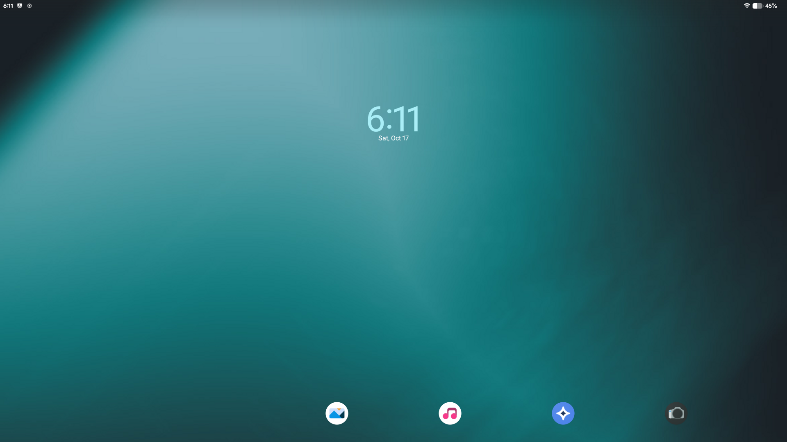
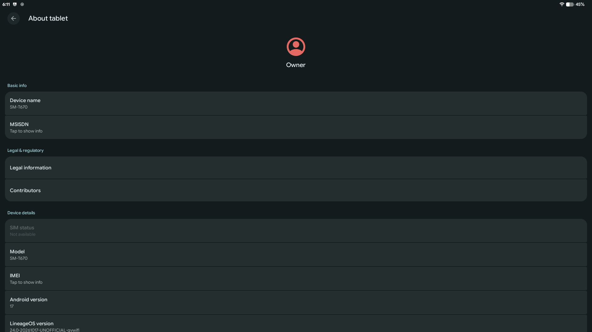
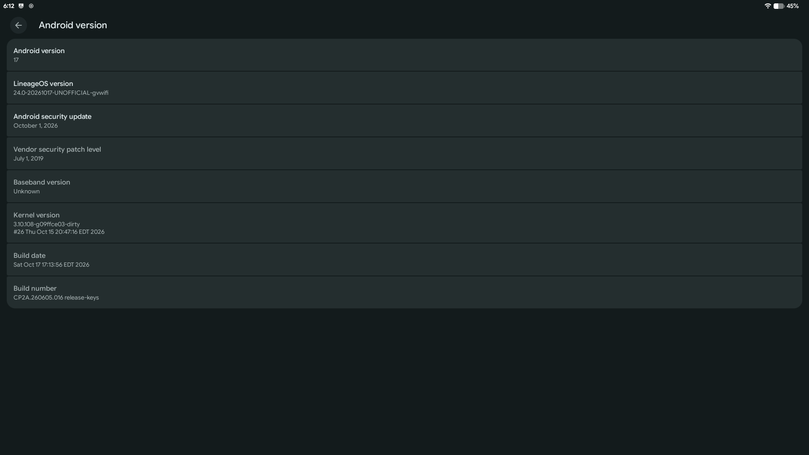
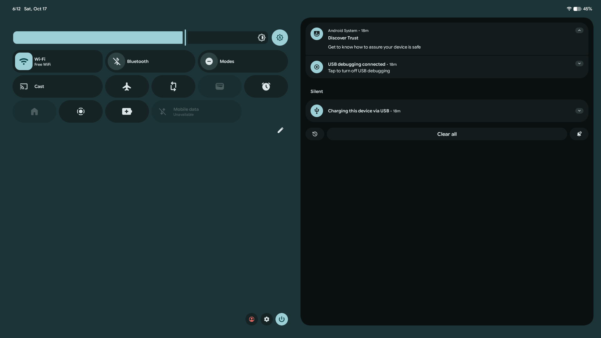
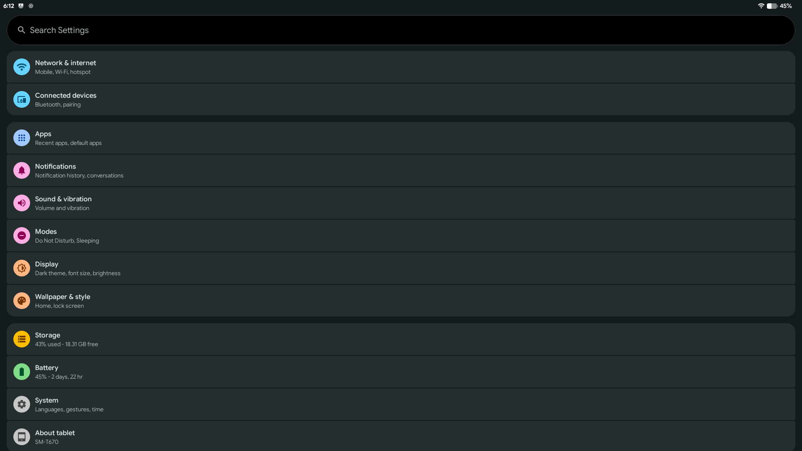

# LineageOS 24.0 (Android 17) for the Galaxy View SM-T670 (`gvwifi`)

**Branch `lineage-24.0`.** Unofficial LineageOS 24.0 for the Wi-Fi Galaxy View (Exynos 7580, Linux 3.10.108):
the LineageOS 23.2 port from the [`main`](https://github.com/gvwifi-los23/lineage-gvwifi/tree/main) branch,
carried forward to Android 17. Status: **early test build**. It boots, runs enforcing, and the basics work;
see [What works](#what-works).

| | |
|---|---|
| Lunch | `lineage_gvwifi-cp2a-userdebug` |
| Source | LineageOS 24.0 + [`local_manifests/gvwifi.xml`](local_manifests/gvwifi.xml) (pinned gvwifi trees) + [`local_manifests/trim24.xml`](local_manifests/trim24.xml) (drops unused Qualcomm projects) |
| Changes | [`patches/<project path>/NNNN-*.patch`](patches), applied by [`scripts/apply-patches.sh`](scripts/apply-patches.sh) (idempotent; nothing is committed into the upstream repos) |
| Kernel | Prebuilt from the 23.2 tree (see [Build](#build)): LineageOS 24 no longer builds kernels with GCC |
| Latest build | `lineage-24.0-20261017-UNOFFICIAL-gvwifi.zip`, release-keys, security patch 2026-10-01 |

The Android 17 port and every fix it needed: [`docs/ANDROID-17.md`](docs/ANDROID-17.md).

## Screenshots
Build 20261017 on the SM-T670 (1920x1080, landscape).

| | |
|---|---|
|  |  |
| Home screen | About tablet |
|  |  |
| Android 17, LineageOS 24.0, kernel 3.10.108 | Quick settings and notifications |
|  | |
| Settings | |

## What works
Checked on the device with build 20261017 (upgrade from 23.2 without a wipe):
- Boot (first boot about 5 minutes, later boots under a minute), SELinux **enforcing**, no crashes
- Wi-Fi with internet; Bluetooth turns on with all profiles (A2DP, AVRCP, headset, HID, PAN, ...)
- Display 1920x1080 at 60 Hz with hardware composition and present fences; audio (speaker)
- GPS provider, microG network location, camera detected, USB/adb
- TWRP 3.7.1_14-A16 still decrypts `/data` after Android 17 has run

Not tested yet: camera capture, video playback smoothness, Bluetooth pairing/audio, MTP mode switching,
the LineageOS Recovery from this branch, a clean install (Format Data) of Android 17.

## Known limitations
The 3.10 kernel lacks BPF features Android 17 expects from kernel 5.10. The port runs the Android 16
(kernel 5.4) variants of the network BPF programs instead, and turns off what can't work:
- no per-app local-network-access notes/metrics and no loopback-access metrics (BPF ring buffers);
- the boot-time loopback self test of `netd` only logs a warning on failure.
Network access, firewall/data-saver rules and traffic statistics use the same programs as on 23.2.

## Build
1. Windows: `scripts\0-setup-wsl.ps1` (WSL Ubuntu 24.04), then in WSL `scripts/1-host-setup.sh`
2. `scripts/2-sync.sh`: syncs LineageOS 24.0 with the local manifests (~100 GB)
3. **Kernel:** LineageOS 24 builds kernels with LLVM only, and this 3.10 kernel needs GCC 4.9. Build it in a
   LineageOS 23.2 tree from the [`main`](https://github.com/gvwifi-los23/lineage-gvwifi/tree/main) branch
   (`scripts/3-build.sh kernel`) and copy `out/target/product/gvwifi/kernel` and `dt.img` into
   `prebuilt-kernel/` here. The same kernel and dt.img run both Android versions.
4. `tools/HeliBoard/build.sh`: builds the Galaxy View keyboard APK (see the `main` branch README)
5. `scripts/3-build.sh`: applies the patches, copies the prebuilt kernel, builds ROM zip + recovery
   - `KEEP_GOING=1`, `CCACHE=1`, `JOBS=N`. Soong analysis needs about 15 GB of RAM: with 28 GB for WSL,
     `JOBS=4` worked; more jobs ran out of memory.

Builds are signed with release keys from `~/gvwifi-keys/release` when present (the maintainer's keys are
**not** published); otherwise with AOSP test keys, which can't be installed over a release-keys build
without wiping data. The maintainer's 24.0 builds use the same keys as the 23.2 builds, so they install
over 23.2 without a wipe.

## Docs
- [`docs/ANDROID-17.md`](docs/ANDROID-17.md): the Android 17 port, patch by patch
- [`docs/BUILD-KIT.md`](docs/BUILD-KIT.md): every 23.2 fix and why (all carried into this branch)
- [`docs/FLASHING.md`](docs/FLASHING.md): stock to LineageOS with Odin + recovery (same steps for 24.0)
- [`CHANGELOG.md`](CHANGELOG.md)

## Hardware notes
- No accelerometer: the rotation tile toggles landscape/portrait (`frameworks/base` 0001).
- Charging only via the 19 V barrel adapter; micro-USB doesn't charge (it shows Discharging).
- The bootloader (S-Boot T670UEU2APJ1) loads the whole boot/recovery image at `0x40204800` and
  copies the ramdisk to `0x42000000`: images over ~31.4 MB don't boot.
- Key combos: recovery = Power + Volume Up; download mode = Power + Volume Down + Home;
  force restart = Power + Volume Down.

## Licenses
Each patch is licensed like the project it modifies (kernel: GPL-2.0; AOSP/LineageOS: Apache-2.0).
The gvwifi Tweaks app (`tools/GvwifiTweaks`) is Apache-2.0. The HeliBoard patches (`tools/HeliBoard`)
are GPL-3.0, like HeliBoard.
